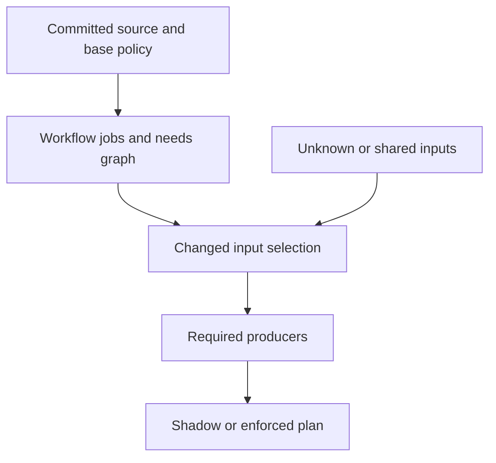

# Architecture and API — 0.2.0

## Components

| Component          | Role                                                                        |
| ------------------ | --------------------------------------------------------------------------- |
| src/audit.mjs      | Bounded GitHub metadata collection and replayable duration analysis.        |
| src/planner.mjs    | YAML job discovery, policy validation, selection and immutable Git reading. |
| bin/ci-planner.mjs | Argument validation, JSON output and Action output boundary.                |
| action.yml         | Small adapter using pinned package inputs and shell argument arrays.        |

There is no server or shared mutable planning database. Parallel PR runs read their own commits and write only to their own stdout/Action output file. Plans bind repository, base, head, merge and event. A plan is not portable authority for another PR.

## Planning flow

The Git adapter verifies full commit identities and reads workflow objects from the tested merge or PR head. Policy always comes from base. With a tested merge, selection uses base..merge; without it, merge-base..head supports shadow review.

The model rebuilds the graph on every invocation. New workflows and jobs appear automatically and run until an owner scopes them. This is adaptation of generated state, not permission for PR descriptions or an LLM to rewrite safety policy.

A selected data producer invalidates its downstream consumers. A skip needs an unchanged owner-declared complete input set, resolvable local job dependencies and supported execution metadata. New jobs, changed global inputs, unknown paths and uncertainty select fresh work. Selected consumers retain their producers.

Enforcement needs both caller opt-in and an enforce policy at base, a pull_request event, and a verified merge with exact base/head parents. Otherwise every run boolean is true.

## Audit flow

The collector lists up to 20 runs and reads the exact listed attempt, paging up to 500 jobs per run. It retains only metadata needed for replay. Changed page counts fail collection; truncated inventories remain partial in replay.

The audit validates identities, sums job intervals, clips work after the first failure, and groups repeated successful source/workflow/event observations. It does not prove redundancy. Timings do not control selection.

## API

All exported functions have JSDoc annotations. Import from the installed package's /audit or /planner entry points, or from the source modules.

| Export                          | Input                                                                | Result                                                                          |
| ------------------------------- | -------------------------------------------------------------------- | ------------------------------------------------------------------------------- |
| collectSnapshot(options, read?) | repository, optional branch/workflow/limit, injectable GET transport | Promise of schema-versioned audit snapshot.                                     |
| auditSnapshot(snapshot)         | Bounded metadata snapshot                                            | Validated audit report.                                                         |
| githubRead(endpoint)            | REST endpoint                                                        | GET response through installed gh. The collector constructs metadata endpoints. |
| discoverWorkflows(sources)      | workflow path → YAML text                                            | Map of job nodes, needs edges, implicit inputs and uncertainty.                 |
| patternMatches(pattern, path)   | Supported input glob and repository path                             | Boolean; throws for unsupported syntax.                                         |
| buildPlan(options)              | Normalized data model                                                | Pure versioned plan.                                                            |
| planRepository(options)         | root, full base/head, optional merge and planning flags              | Plan from verified Git objects.                                                 |

Use planRepository when driving CI. buildPlan is a pure model for tests and trusted adapters; its verifiedMerge flag must never be accepted from untrusted PR JSON. CLI consumers must check exit status, source identity and output readiness.

Hashes bind data to the model version but are not signed attestations. This release does not implement cross-run result reuse, evidence expiry, environment attestation or a remote plan store.

## Bounds and failure behavior

The implementation bounds file counts, workflows, jobs, source bytes, policy bytes, patterns and audit pages. YAML duplicate keys and unknown tags refuse planning. Bounded aliases keep their workflow fresh while unrelated workflows can still plan. Missing/cyclic/dynamic needs refuse planning. The wrapper emits no ready flag on failure, so a correctly integrated workflow runs its existing jobs.

The tool does not execute repository scripts to discover inputs. That limits inference but keeps analysis separate from PR execution. The composite Action installs its own pinned parser with lifecycle scripts disabled.

## Tests and next work

Tests cover timing/attempt errors, pagination, graph discovery, producer retention, unsupported syntax, policy trust, merge parents, dirty checkout isolation and CLI outputs. Fixtures use generic repositories and data.

Future work includes source dependency inference, optimization proposals, richer observations and verified reuse. Those need separate adversarial evidence and must preserve current fallback behavior. No hosted App or automatic workflow rewriting is shipped in 0.2.0.

## Repository completeness audit

The repository-audit module compares Node/TypeScript signals with traced PR invocations. It follows package scripts, simple shell wrappers, local reusable workflows and composite actions. Reports distinguish covered, conditional, unverified and missing checks and retain evidence locations. See [the full guide](repository-audit.md). This analysis does not change selection policy or add jobs automatically.
