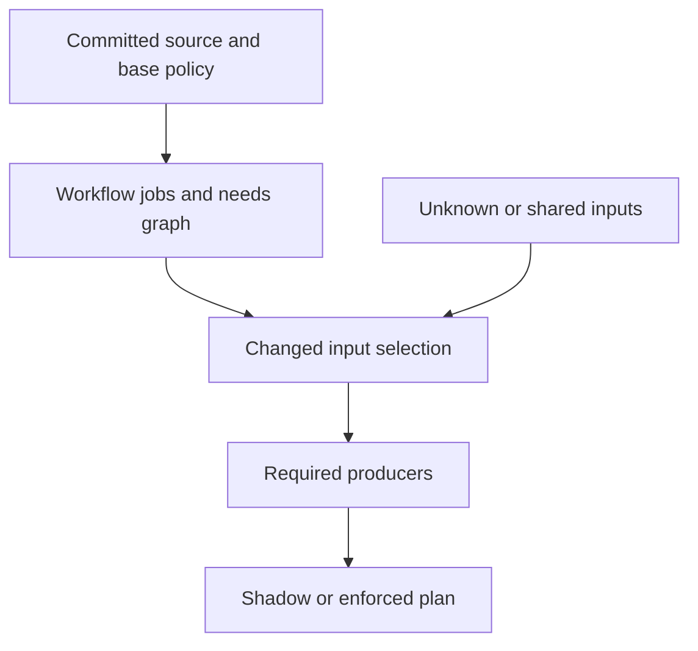

# Architecture and API — 0.3.0

## Components

| Component               | Role                                                                             |
| ----------------------- | -------------------------------------------------------------------------------- |
| src/audit.mjs           | Bounded GitHub metadata collection and replayable duration analysis.             |
| src/planner.mjs         | YAML job discovery, policy validation, selection and immutable Git reading.      |
| src/reports.mjs         | Escaped, bounded Markdown views and summary presentation.                        |
| src/setup.mjs           | Pure onboarding proposals and explicit exclusive local writes.                   |
| src/fix-pr.mjs          | Offline fix previews and explicit local-only draft PR publication.               |
| src/dependencies.mjs    | Advisory workspace, import and TypeScript dependency discovery.                  |
| src/skip-validation.mjs | Compare shadow plans to explicit ungated full-run observations.                  |
| src/reuse.mjs           | Owner-signed full-run receipts, expiry, environment and live reuse verification. |
| src/performance.mjs     | Timing-based shard, install, cache and finishing-tail review advice.             |
| bin/ci-planner.mjs      | Argument validation, JSON output and Action output boundary.                     |
| action.yml              | Small adapter using pinned package inputs and shell argument arrays.             |

There is no server or shared mutable planning database. Parallel PR runs read their own commits and write only to their own stdout, Action output file and job summary. Plans bind repository, base, head, merge and event. A plan is not portable authority for another PR.

## Planning flow

The Git adapter verifies full commit identities and reads workflow objects from the tested merge or PR head. Policy always comes from base. With a tested merge, selection uses base..merge; without it, merge-base..head supports shadow review.

The model rebuilds the graph on every invocation. New workflows and jobs appear automatically and run until an owner scopes them. This is adaptation of generated state, not permission for PR descriptions or an LLM to rewrite safety policy.

A selected data producer invalidates its downstream consumers. A skip needs an unchanged owner-declared complete input set, resolvable local job dependencies and supported execution metadata. New jobs, changed global inputs, unknown paths and uncertainty select fresh work. Selected consumers retain their producers.

Enforcement needs both caller opt-in and an enforce policy at base, a pull_request event, and a verified merge with exact base/head parents. Otherwise every run boolean is true.

## Audit flow

The collector lists up to 20 runs and reads the exact listed attempt, paging up to 500 jobs per run. It retains only metadata needed for replay. Changed page counts fail collection; truncated inventories remain partial in replay.

The audit validates identities, sums job intervals, clips work after the first failure, and groups repeated successful source/workflow/event observations. It does not prove redundancy. Timings do not control selection.

## API

Public functions have source annotations. Import from the installed package's /audit, /planner, /repository-audit, /check-proposals, /reports, /setup or /fix-pr entry points. Additional public exports are /dependencies, /skip-validation, /reuse and /performance.

| Export                                | Input                                                                | Result                                                                          |
| ------------------------------------- | -------------------------------------------------------------------- | ------------------------------------------------------------------------------- |
| collectSnapshot(options, read?)       | repository, optional branch/workflow/limit, injectable GET transport | Promise of schema-versioned audit snapshot.                                     |
| auditSnapshot(snapshot)               | Bounded metadata snapshot                                            | Validated audit report.                                                         |
| githubRead(endpoint)                  | REST endpoint                                                        | GET response through installed gh. The collector constructs metadata endpoints. |
| discoverWorkflows(sources)            | workflow path → YAML text                                            | Map of job nodes, needs edges, implicit inputs and uncertainty.                 |
| patternMatches(pattern, path)         | Supported input glob and repository path                             | Boolean; throws for unsupported syntax.                                         |
| buildPlan(options)                    | Normalized data model                                                | Pure versioned plan.                                                            |
| planRepository(options)               | root, full base/head, optional merge and planning flags              | Plan from verified Git objects.                                                 |
| renderMarkdown(report)                | Supported structured result                                          | Escaped bounded Markdown; no mutation or authority changes.                     |
| proposeSetup(snapshot, options)       | Immutable snapshot and optional reviewed Action ref                  | Advisory workflow and incomplete shadow policy preview.                         |
| initializeRepository(options)         | root, optional write and actionRef                                   | Git-backed preview or exclusive local setup files.                              |
| previewFix(options)                   | root                                                                 | Additive workflow proposal and before/after static audit counts.                |
| openFixPullRequest(options, request?) | root, explicit repository, injectable GET/POST transport             | Draft PR receipt after exact default-branch binding, or a no-op preview.        |
| fixPullRequestBody(preview, identity) | Generated preview and repository/branch/base                         | Bounded explanation, limitations and rollback.                                  |

Use planRepository when driving CI. buildPlan is a pure model for tests and trusted adapters; its verifiedMerge flag must never be accepted from untrusted PR JSON. CLI consumers must check exit status, source identity and output readiness.

Hashes bind data to the model version but are not signed attestations. The separate reuse command verifies owner-signed receipts, age, a measured environment digest and live metadata. There is no remote plan store. See [evidence and performance](evidence-and-performance.md) for the coordinator trust boundary.

## Bounds and failure behavior

The implementation bounds file counts, workflows, jobs, source bytes, policy bytes, patterns and audit pages. YAML duplicate keys and unknown tags refuse planning. Bounded aliases keep their workflow fresh while unrelated workflows can still plan. Missing/cyclic/dynamic needs refuse planning. The wrapper emits no ready flag on failure, so a correctly integrated workflow runs its existing jobs.

The tool does not execute repository scripts to discover inputs. readDependencySnapshot reads bounded regular Git blobs; discoverDependencies returns advisory scopes and explicit unknowns. validateSkipDecisions compares one shadow observation, and validationAllowsPlanning may only inhibit the normal planner gates. attestValidation signs a coordinator-asserted full run; verifyReuse reads the reuse contract from the target's first parent and checks the current default-branch head and live exact attempt. advisePerformance produces review prompts from snapshot steps. That limits inference but keeps analysis separate from PR execution. The composite Action ships reviewed, lockfile-pinned parsers as vendored files and performs no runtime registry installation.

## Tests and next work

Tests cover timing/attempt errors, pagination, graph discovery, producer retention, unsupported syntax, policy trust, merge parents, dirty checkout isolation and CLI outputs. Fixtures use generic repositories and data.

Further work includes complete language-aware dependency analysis, automatic performance patches and richer runtime observations. Those need separate adversarial evidence and must preserve current fallback behavior. The shipped fix publisher adds one new workflow only on explicit owner invocation; it does not rewrite existing CI or provide a hosted App.

## Repository completeness audit

The repository-audit module compares Node/TypeScript, Python, Go and explicit Dockerfile signals with traced PR invocations. It follows package scripts, simple shell wrappers, local reusable workflows and composite actions. Reports distinguish covered, conditional, unverified and missing checks and retain evidence locations. See [the full guide](repository-audit.md). This analysis does not change selection policy or add jobs automatically.

## Setup and publication boundaries

Reports are a presentation layer: they cannot change a job decision or plan hash. Setup reads immutable Git objects, creates incomplete shadow contracts and leaves existing CI intact. Explicit writes require a clean local checkout and fixed exclusive target paths.

The fix publisher regenerates its proposal from Git, requires the exact remote default-branch commit, and uses bounded GET/POST GitHub calls to create a new tree, commit, branch and draft PR. It never updates an existing ref. Branch collisions, base drift and CI event contexts stop publication. A partial response leaves the created branch visible for recovery. Normal PR CI can start after publication. See [setup and fixes](onboarding-and-fixes.md) and [reports](reports.md).

## Evidence APIs

| Export                                                                       | Input                                                                                          | Result                                                                              |
| ---------------------------------------------------------------------------- | ---------------------------------------------------------------------------------------------- | ----------------------------------------------------------------------------------- |
| discoverDependencies(snapshot, changes?)                                     | Immutable JS/TS snapshot and changed paths                                                     | Workspace edges, affected packages, suggested incomplete input scopes and unknowns. |
| validateSkipDecisions(observation)                                           | Shadow plan, exact run snapshot, tested merge, full-run assertion and display-name map         | Validation feedback; unsafe evidence requires a full run.                           |
| validationAllowsPlanning(report, policyHash, workflow, planHash, repository) | Optional trusted feedback                                                                      | Boolean that may inhibit existing policy gates.                                     |
| attestValidation(options, read?)                                             | Trusted tested commit/environment/full-run assertions, signing-key file and live GET transport | Signed Ed25519 receipt; forbidden in PR contexts.                                   |
| verifyReuse(options, read?)                                                  | Receipt, trusted pre-push base, target commit/environment and live GET transport               | Explicit reuse result; run=true on any uncertainty.                                 |
| advisePerformance(snapshot)                                                  | Bounded run/job/step and optional instrumented cache metadata                                  | Timing review prompts, unknown or observed cache hit rate, null savings/billing.    |

## Advisory replay and static test selection

`replayHistory` independently collects bounded merged-PR run attempts and checkout log observations under an explicit owner-reviewed workflow/matrix/required-step contract. `selectAffectedTests` returns conservative default JavaScript ESM test selection and a consumer-ready matrix. Neither module grants enforcement authority or infers complete job inputs. `suggestJobInputs` follows literal invocations/imports and retains broad scopes when evidence is opaque. See the [contracts and executable consumer](audit-roadmap.md). Git object readers share SHA-1/SHA-256 and workflow/option boundaries; GitHub Action pins remain SHA-1.
